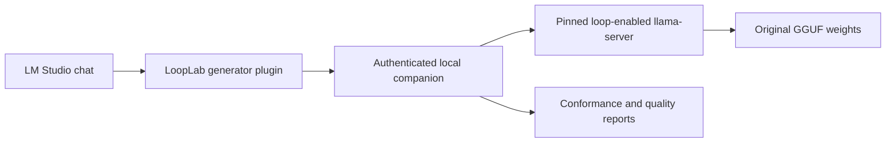

# LoopLab for LM Studio

LoopLab adds an LM Studio generator plugin, a local inference companion, and automatic tests for training-free latent recurrence. It uses the original GGUF weights through a separately installed, pinned llama.cpp build. LM Studio's bundled runtimes stay independent of this project.

**Experimental research software.** Passing a compatibility or numerical test does not demonstrate improved model quality. The recommended profile stays on the original model unless a selected loop configuration improves a separate held-out diagnostic set with sufficient paired evidence.



## What is implemented

The native adapter implements damped Euler recurrence and anchoring from [Training-Free Looped Transformers, arXiv:2605.23872](https://arxiv.org/html/2605.23872v1):

```text
natural = g(input)
state = input
repeat K times:
    state = state + (g(state) - state) / K
output = beta * natural + (1 - beta) * state
```

The first evaluation of `g(input)` is shared between the natural output and the first substep. `beta=1` recovers the original block output; `K=1` runs the ordinary model.

- Dense `llama`, `qwen2`, and `qwen3` graphs support block or layer recurrence.
- `qwen3moe` uses layer recurrence with the first iteration's expert IDs **and mixture weights** reused across substeps.
- A structural adapter generator preserves recognizable native decoder-layer bodies and adds experimental support for related architectures. The pinned source currently yields 93 candidates, including Granite, InternLM2, Mistral3, Phi3 and several sliding-window families. This count is **generated candidates, not validated architectures**.
- Each pass uses the same model tensors and original token positions. The KV cache has the original number of layers.
- `cache=first` preserves the first pass's current-position K/V and restores them after refinement. `cache=last` computes a separate stash pass from the refined output. Existing prefix rows are preserved.
- Loop iterations execute at prefill and decode. Native graph ordering finishes attention reads before the next pass overwrites current-position KV rows.
- Vulkan fusion is disabled for baseline and loop runs: retaining intermediate KV tensors otherwise changes fusion choices and can break the quantized anchor-identity check. Flash attention is disabled and KV storage is F16.

This is an independent implementation of the equations and selected cache policies, **not a reproduction of the paper's published scores**. Its GGUF quantization, diagnostic tasks, and runtime differ from the paper's BF16/Transformers evaluations. The paper has variations between its main recipe, appendices, and linked example; this repository states its exact implemented behavior.

Specifically, LoopLab follows the **K substeps** in Equations 10 and 13–16; Algorithm 3 prints a different loop bound. In layer mode, `cache=first` uses each layer's own saved input. These choices are explicit so the numerical reference checks a defined operator. The current evaluator uses full decode looping and one fixed middle window; it does not reproduce the paper's broader window search, decode-bypass variants or benchmark harness.

## Automatic testing

Use the plugin's **Find models**, **Auto-test selected model**, **Auto-test all local models**, **Show report**, and **Cancel active tests** actions.

For broad, best-effort compatibility, use **Explore all models, including experimental adapters**. It discovers LM Studio files, Ollama manifest blobs and locally cached Hugging Face GGUFs, deduplicates shared files, and tests every loadable original checkpoint. Embedding checkpoints get finite-vector tests. Vision projectors, old static-repeat variants, split files and models beyond the memory budget get explicit outcomes.

The [local model survey](reports/all-local-survey.md) lists every discovered file, its baseline result and which loop counts passed. Adding another checkpoint of a recognized family only requires running exploration again; each new job refreshes discovery.

Exploration tests baseline generation, then K=2/3/4 anchor identity, finite looped output, a measurable change from baseline and repeat-request stability. A successful profile becomes manually selectable and stays labeled experimental. It never changes the recommended profile or claims a quality gain. A partially compatible model can expose only its passing profiles. These checks are intentionally much lighter than the quality evaluation below.

Unrecognized graphs and failed models produce local repair handoffs under `~/.local/state/looplab/repairs/`: metadata, representative tensor names/shapes, native-source information, sanitized errors and a reproduction command. A later coding LLM can use them to extend the adapter. LoopLab does not send weights or reports to an external LLM. Completed exploration results are reused only for matching model and runtime fingerprints; `--no-resume` forces a rerun.

The generator recognizes ordinary KV and sliding-window KV interfaces. It rejects unknown recurrent/convolution/MLA state and unrecognized residual-stream boundaries. Sliding-window experiments allocate the full cache and retain the model's attention mask. Only the original four architectures have the independent numerical reference; generated adapters require per-checkpoint smoke checks and remain a weaker evidence tier.

The evaluator performs:

1. **Read-only preflight:** inspect GGUF metadata and the built adapter catalog; reject missing adapters, split files, embedding models, existing static conversions and models over the configured size budget.
2. **Baseline:** evaluate the original model using the same runtime and decoding settings.
3. **Anchor identity:** test each candidate with `beta=1` and compare generated token IDs and aligned top-token log probabilities to baseline. Failed identities cannot be selected for chat.
4. **Selection:** test 2, 3 and 4 passes with `beta=0.5`, a four-layer middle window, and `cache=first` on 12 diagnostic tasks.
5. **Holdout:** evaluate only the selected candidate on 12 different tasks. Promotion requires a one-sided paired sign-test p-value at most 0.05 and more wins than losses. Ties prefer fewer passes. Quick mode never promotes.
6. **Cache and storage probes:** report prompt reuse separately and record free space, report size and model bytes written. Generated text is parsed as JSON; it is never executed.

All quality runs use the same constrained JSON answer prefix, a 192-token answer budget, greedy decoding and disabled explicit reasoning. This avoids spending the whole diagnostic budget inside a reasoning block. These settings are recorded and hashed with the task suite. Truncations, format failures, token counts and elapsed time are reported alongside accuracy.

The small public diagnostic suite covers code tracing, sorting, intervals and simple reasoning. It can detect regressions, but it is not a substitute for a large coding benchmark or your own workloads. Selection results and held-out results are reported separately. A model that loads successfully is not automatically called paper-compatible or better.

The 2/3/4-pass sweep is a bounded starting point, not an established upper limit on useful recurrence. The native integrator supports up to eight passes; the plugin deliberately exposes only candidates covered by its automatic sweep.

An independent NumPy test generates tiny F32 GGUF networks and compares full next-token distributions across prefill and autoregressive decode. It covers RMSNorm, RoPE, causal attention, SwiGLU, MoE routing, both cache policies and the anchor identity for the four reference-validated architectures. No pretrained weights are downloaded for this test.

## Install on Linux

Requirements: Python 3.10+, Git, C++17 compiler, Ninja, Node 22+, npm, and LM Studio with `lms` on PATH. Vulkan additionally needs a working Vulkan loader/driver and `glslc`. The build helper downloads pinned development headers into `.runtime/`; it does not install system packages.

```sh
git clone https://github.com/bouldinnathan/lmstudio-looplab.git
cd lmstudio-looplab
python3 -m venv .venv
.venv/bin/pip install cmake numpy pytest
.venv/bin/python scripts/build_runtime.py
.venv/bin/pip install -e . -e .runtime/llama.cpp/gguf-py
.venv/bin/python tests/native_reference.py --output .looplab/reference-cpu.json
.venv/bin/python tests/native_reference.py --gpu-layers 999 --output .looplab/reference-vulkan.json
```

For a CPU-only build, pass `--cpu` to `scripts/build_runtime.py`, omit the Vulkan reference check, and launch the companion with `--gpu-layers 0`.

Start the companion:

```sh
.venv/bin/python -m looplab serve
```

Alternatively, install the optional systemd user service. It keeps the companion available and starts it when you log in:

```sh
.venv/bin/python scripts/service.py install --enable
systemctl --user status looplab
# To remove the service later:
.venv/bin/python scripts/service.py remove
```

Install the generator in a second terminal:

```sh
cd plugin
npm ci
npm test
lms dev --install --yes
```

Open LM Studio's **Chat** page, open the model picker at the top, and search for **looplab**. Select **bouldinnathan/looplab** under **Your Generators**. Set the action to **Find models** and send a message. Enter a returned model name or ID in the plugin settings, choose an action/profile, and send another message. Blank model selection also lists models.

If LoopLab seems missing, check which picker is open. In LM Studio 0.4.25+1, the **Developer/server** model picker does not display generators. **My Models** lists model files; LoopLab does not create additional GGUF entries. Generator plugins also appear in the Chat model picker rather than the ordinary tools-plugin list, as described in [LM Studio's generator documentation](https://lmstudio.ai/docs/typescript/plugins/generator). Search for `looplab` in that picker, then enter the underlying model name in LoopLab's settings. Searching the picker for `gpt-oss` finds the original model, not the shared LoopLab generator.

The companion listens only on `127.0.0.1:7341`. The plugin reads the local token from `$XDG_STATE_HOME/looplab/token` or `~/.local/state/looplab/token`; no copy/paste is needed for the standard installation. An explicitly configured token is also supported. Custom state directories require that token setting.

The plugin streams text and reasoning, forwards function tools and tool results, handles cancellation, and supports text conversations. Images and attachments are rejected explicitly.

Each chat answer identifies the active mode: **original model** or the actual number of **experimental loop passes**. Choosing the recommended profile can select the original model when the diagnostics do not demonstrate a benefit.

The original model-library entries keep their existing names. In **Chat → model picker → Your Generators**, select **bouldinnathan/looplab**, enter the model name or ID in its settings, and choose **2**, **3**, or **4 passes, anchored damping (experimental)** in **Loop profile**. An active looped reply starts with a banner such as **LoopLab · 2 passes (experimental)**; baseline replies say **LoopLab · original model**. **Show selected model's report** lists which pass counts passed testing. Older files named `*-looped-2x-mid4` are legacy static-repeat conversions, separate from these runtime loop profiles.

## Commands and resource limits

```sh
# Inspect without loading any model
.venv/bin/python -m looplab scan

# Screen one model; never promotes a quick result
.venv/bin/python -m looplab test qwen3-coder-30b --quick

# Full tests; one model/profile at a time
.venv/bin/python -m looplab test all

# Broad compatibility survey, including new candidates and repair handoffs
.venv/bin/python -m looplab explore all --output reports/all-local-survey.json
.venv/bin/python -m looplab explore granite4.1-3b --no-resume

# Add a model root or test a single original GGUF
.venv/bin/python -m looplab --models /path/to/models scan
.venv/bin/python -m looplab --models /path/to/model.gguf test all

# Explicit budgets and context
.venv/bin/python -m looplab --max-model-gib 24 --context 2048 serve

# Export a public, allowlisted summary, without local paths or conversations
.venv/bin/python -m looplab export-report local-report.json public-summary.json
```

The default file-size ceiling is 80 GiB, with an additional available-RAM check: estimated weights/working memory plus an 8 GiB reserve must fit. Models above 32 GiB use CPU inference to avoid large GPU allocations. This estimate cannot guarantee that every graph fits; failures are recorded. There is one worker and a 2,048-token context. Override the file ceiling with `--max-model-gib`.

The companion unloads an idle worker after five minutes. Inference stops if the state filesystem has less than 2 GiB free. Worker logs rotate at 8 MiB, with at most 64 log files retained. Models are never downloaded, modified, reflinked or copied by this workflow. Source/build files and reports still consume disk space. Full tests can take a long time on larger dense models; cancellation takes effect between requests.

CLI and companion instances using the same state directory share a process lock, preventing competing model loads. The companion also serializes jobs and rejects chat requests while it evaluates. Different state directories have independent locks.

Default discovery includes `$OLLAMA_MODELS`, `~/.ollama/models`, and `/usr/share/ollama/.ollama/models`, as applicable. Original GGUF files can also be selected through `--models /path/to/blob`, or existing LM Studio model links. LoopLab runs their inference in its companion; it does not add recurrence support to the Ollama server itself.

## Updating LM Studio

The plugin uses LM Studio's documented generator API, and the engine is installed under this repository's `.runtime/` directory. Updating an LM Studio runtime pack therefore does not replace this engine. A future incompatible plugin API change may require an adapter update; the SDK labels plugin APIs experimental.

The llama.cpp revision, development-header revisions, plugin dependencies and build patch fingerprint are pinned. Model test records include the original header hash, file size/modification time, exact loop configuration, patch fingerprint, context and execution settings. Changing these invalidates the corresponding loop-profile approval. The header hash is not a full hash of every weight byte; deliberately preserving all file metadata while replacing weights is outside this check.

The expanded runtime lives in `.runtime/auto/`; an earlier `.runtime/build/` installation is preserved. Rebuilding updates only files recorded as managed by LoopLab and refuses to overwrite manual changes. Adding a checkpoint of a recognized family requires discovery and testing, not an LM Studio engine edit.

**Cross-request prompt-prefix caching is currently disabled for chat.** Normal token-by-token KV caching within a response remains enabled. Each loop profile needs separate cache identity, and partial prompt reuse can change recurrent prefill semantics. Reports include an experimental cache comparison; a passing single probe does not enable caching automatically. Reuse of weight tensors inside one run is implemented.

## Current boundaries

- Kimi/DeepSeek MLA and hybrid/recurrent state still need explicit adapters. Exploration can run their baseline if the pinned loader supports the checkpoint and it fits memory.
- Generated adapters are best-effort candidates. Checkpoint format differences can fail before looping even begins; repair reports distinguish loader, state-adapter and conformance failures.
- Some multimodal architectures can run their text component, but the plugin accepts text/tool messages only. Projectors are inventoried separately.
- The companion currently manages one loaded profile. Switching profiles restarts the worker and invalidates KV state.
- The graphical plugin, companion and native runtime are separate components. Installing only the plugin does not add loop support to LM Studio's bundled engine.
- Dependency status and local API boundaries are documented in [SECURITY.md](SECURITY.md).

## Development and validation

```sh
.venv/bin/python -m pytest -q
npm --prefix plugin test
.venv/bin/python tests/native_reference.py
```

GitHub Actions runs application tests, plugin tests, and a CPU native-reference build using synthetic fixtures. Published numerical and model summaries live in [`reports/`](reports/). Private model inventories, logs, full outputs and access tokens are kept outside Git.

The older `loop_gguf.py`, `manage_looped.py`, and `check_generation.py` utilities remain available for existing static-repeat experiments. Those generated files are a different method and are rejected as inputs to the new runtime workflow. Their original model data remains untouched.

## License and attribution

LoopLab code is licensed under **AGPL-3.0-or-later**, a copyleft license. See [LICENSE](LICENSE). Model weights retain their own licenses and are not included. llama.cpp and other dependencies retain their respective licenses; see [NOTICE](NOTICE).

This project was developed with substantial AI assistance. It is an independent project, not an official LM Studio, llama.cpp, or paper-author release.
