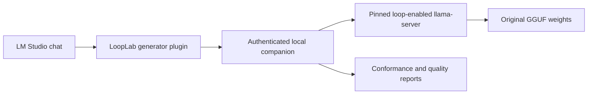

# LoopLab for LM Studio

LoopLab adds an LM Studio generator plugin, a local inference companion, and automatic tests for training-free latent recurrence. It uses the original GGUF weights through a separately installed, pinned llama.cpp build. LM Studio's bundled runtimes stay independent of this project.

**Experimental research software.** Passing a compatibility or numerical test does not demonstrate improved model quality. The recommended profile stays on the original model unless a selected loop configuration improves a separate held-out diagnostic set with sufficient paired evidence.



## What is implemented

The native adapter implements damped Euler recurrence and anchoring from [Training-Free Looped Transformers, arXiv:2605.23872](https://arxiv.org/html/2605.23872v1):

```text
natural = g(input)
state = input
repeat K times:
    state = state + (g(state) - state) / K
output = beta * natural + (1 - beta) * state
```

The first evaluation of `g(input)` is shared between the natural output and the first substep. `beta=1` recovers the original block output; `K=1` runs the ordinary model.

- Dense `llama`, `qwen2`, and `qwen3` graphs support block or layer recurrence.
- `qwen3moe` uses layer recurrence with the first iteration's expert IDs **and mixture weights** reused across substeps.
- Each pass uses the same model tensors and original token positions. The KV cache has the original number of layers.
- `cache=first` preserves the first pass's current-position K/V and restores them after refinement. `cache=last` computes a separate stash pass from the refined output. Existing prefix rows are preserved.
- Loop iterations execute at prefill and decode. Native graph ordering finishes attention reads before the next pass overwrites current-position KV rows.
- Vulkan fusion is disabled for baseline and loop runs: retaining intermediate KV tensors otherwise changes fusion choices and can break the quantized anchor-identity check. Flash attention is disabled and KV storage is F16.

This is an independent implementation of the equations and selected cache policies, **not a reproduction of the paper's published scores**. Its GGUF quantization, diagnostic tasks, and runtime differ from the paper's BF16/Transformers evaluations. The paper has variations between its main recipe, appendices, and linked example; this repository states its exact implemented behavior.

## Automatic testing

Use the plugin's **Find models**, **Auto-test selected model**, **Auto-test all local models**, **Show report**, and **Cancel active tests** actions.

The evaluator performs:

1. **Read-only preflight:** inspect GGUF metadata; reject unsupported architectures, split files, embedding models, sliding-window variants, existing static conversions and models over the configured size budget.
2. **Baseline:** evaluate the original model using the same runtime and decoding settings.
3. **Anchor identity:** test each candidate with `beta=1` and compare generated token IDs and aligned top-token log probabilities to baseline. Failed identities cannot be selected for chat.
4. **Selection:** test 2, 3 and 4 passes with `beta=0.5`, a four-layer middle window, and `cache=first` on 12 diagnostic tasks.
5. **Holdout:** evaluate only the selected candidate on 12 different tasks. Promotion requires a one-sided paired sign-test p-value at most 0.05 and more wins than losses. Ties prefer fewer passes. Quick mode never promotes.
6. **Cache and storage probes:** report prompt reuse separately and record free space, report size and model bytes written. Generated text is parsed as JSON; it is never executed.

All quality runs use the same constrained JSON answer prefix, a 192-token answer budget, greedy decoding and disabled explicit reasoning. This avoids spending the whole diagnostic budget inside a reasoning block. These settings are recorded and hashed with the task suite. Truncations, format failures, token counts and elapsed time are reported alongside accuracy.

The small public diagnostic suite covers code tracing, sorting, intervals and simple reasoning. It can detect regressions, but it is not a substitute for a large coding benchmark or your own workloads. Selection results and held-out results are reported separately. A model that loads successfully is not automatically called paper-compatible or better.

The 2/3/4-pass sweep is a bounded starting point, not an established upper limit on useful recurrence. The native integrator supports up to eight passes; the plugin deliberately exposes only candidates covered by its automatic sweep.

An independent NumPy test generates tiny F32 GGUF networks and compares full next-token distributions across prefill and autoregressive decode. It covers RMSNorm, RoPE, causal attention, SwiGLU, MoE routing, both cache policies and the anchor identity for all four adapters. No pretrained weights are downloaded for this test.

## Install on Linux

Requirements: Python 3.10+, Git, C++17 compiler, Ninja, Node 22+, npm, and LM Studio with `lms` on PATH. Vulkan additionally needs a working Vulkan loader/driver and `glslc`. The build helper downloads pinned development headers into `.runtime/`; it does not install system packages.

```sh
git clone https://github.com/bouldinnathan/lmstudio-looplab.git
cd lmstudio-looplab
python3 -m venv .venv
.venv/bin/pip install cmake numpy pytest
.venv/bin/python scripts/build_runtime.py
.venv/bin/pip install -e . -e .runtime/llama.cpp/gguf-py
.venv/bin/python tests/native_reference.py --output .looplab/reference-cpu.json
.venv/bin/python tests/native_reference.py --gpu-layers 999 --output .looplab/reference-vulkan.json
```

For a CPU-only build, pass `--cpu` to `scripts/build_runtime.py`, omit the Vulkan reference check, and launch the companion with `--gpu-layers 0`.

Start the companion:

```sh
.venv/bin/python -m looplab serve
```

Alternatively, install the optional systemd user service. It keeps the companion available and starts it when you log in:

```sh
.venv/bin/python scripts/service.py install --enable
systemctl --user status looplab
# To remove the service later:
.venv/bin/python scripts/service.py remove
```

Install the generator in a second terminal:

```sh
cd plugin
npm ci
npm test
lms dev --install --yes
```

Select **bouldinnathan/looplab** from LM Studio's model dropdown. Set the action to **Find models** and send a message. Enter a returned model name or ID in the plugin settings, choose an action/profile, and send another message. Blank model selection also lists models.

The companion listens only on `127.0.0.1:7341`. The plugin reads the local token from `$XDG_STATE_HOME/looplab/token` or `~/.local/state/looplab/token`; no copy/paste is needed for the standard installation. An explicitly configured token is also supported. Custom state directories require that token setting.

The plugin streams text and reasoning, forwards function tools and tool results, handles cancellation, and supports text conversations. Images and attachments are rejected explicitly.

## Commands and resource limits

```sh
# Inspect without loading any model
.venv/bin/python -m looplab scan

# Screen one model; never promotes a quick result
.venv/bin/python -m looplab test qwen3-coder-30b --quick

# Full tests; one model/profile at a time
.venv/bin/python -m looplab test all

# Add a model root or test a single original GGUF
.venv/bin/python -m looplab --models /path/to/models scan
.venv/bin/python -m looplab --models /path/to/model.gguf test all

# Explicit budgets and context
.venv/bin/python -m looplab --max-model-gib 24 --context 2048 serve

# Export a public, allowlisted summary, without local paths or conversations
.venv/bin/python -m looplab export-report local-report.json public-summary.json
```

The default limit is 32 GiB per model, one worker, and a 2,048-token context. The companion unloads an idle worker after five minutes. Inference stops if the state filesystem has less than 2 GiB free. Worker logs rotate at 8 MiB, with at most 64 log files retained. Models are never downloaded, modified, reflinked or copied by this workflow. Source/build files and reports still consume disk space. Full tests can take a long time on larger dense models; cancellation takes effect between requests.

CLI and companion instances using the same state directory share a process lock, preventing competing model loads. The companion also serializes jobs and rejects chat requests while it evaluates. Different state directories have independent locks.

Original GGUF files downloaded by Ollama can also be used through `--models /path/to/blob`, or existing LM Studio model links. LoopLab runs their inference in its companion; it does not add recurrence support to the Ollama server itself.

## Updating LM Studio

The plugin uses LM Studio's documented generator API, and the engine is installed under this repository's `.runtime/` directory. Updating an LM Studio runtime pack therefore does not replace this engine. A future incompatible plugin API change may require an adapter update; the SDK labels plugin APIs experimental.

The llama.cpp revision, development-header revisions, plugin dependencies and build patch fingerprint are pinned. Model test records include the original header hash, patch fingerprint, context and execution settings. Changing the runtime/settings invalidates the corresponding loop-profile approval.

**Prompt-prefix caching is currently disabled for chat.** Each loop profile needs separate cache identity, and partial prompt reuse can change recurrent prefill semantics. Reports include an experimental cache comparison; a passing single probe does not enable caching automatically. Reuse of weight tensors inside one run is implemented.

## Current boundaries

- Kimi/DeepSeek MLA, hybrid/recurrent architectures, multimodal models, and sliding-window architectures do not yet have adapters. They are listed with a reason, not silently converted.
- A new architecture requires a native adapter and an independent numerical reference before it should be enabled.
- The companion currently manages one loaded profile. Switching profiles restarts the worker and invalidates KV state.
- The graphical plugin, companion and native runtime are separate components. Installing only the plugin does not add loop support to LM Studio's bundled engine.
- Dependency status and local API boundaries are documented in [SECURITY.md](SECURITY.md).

## Development and validation

```sh
.venv/bin/python -m pytest -q
npm --prefix plugin test
.venv/bin/python tests/native_reference.py
```

GitHub Actions runs application tests, plugin tests, and a CPU native-reference build using synthetic fixtures. Published numerical and model summaries live in [`reports/`](reports/). Private model inventories, logs, full outputs and access tokens are kept outside Git.

The older `loop_gguf.py`, `manage_looped.py`, and `check_generation.py` utilities remain available for existing static-repeat experiments. Those generated files are a different method and are rejected as inputs to the new runtime workflow. Their original model data remains untouched.

## License and attribution

LoopLab code is licensed under **AGPL-3.0-or-later**, a copyleft license. See [LICENSE](LICENSE). Model weights retain their own licenses and are not included. llama.cpp and other dependencies retain their respective licenses; see [NOTICE](NOTICE).

This project was developed with substantial AI assistance. It is an independent project, not an official LM Studio, llama.cpp, or paper-author release.
