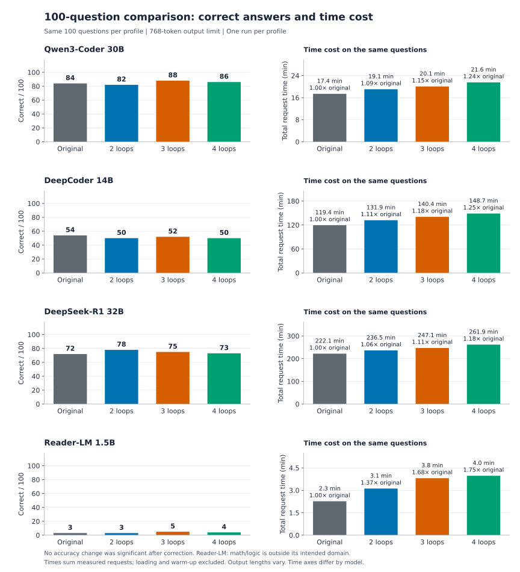
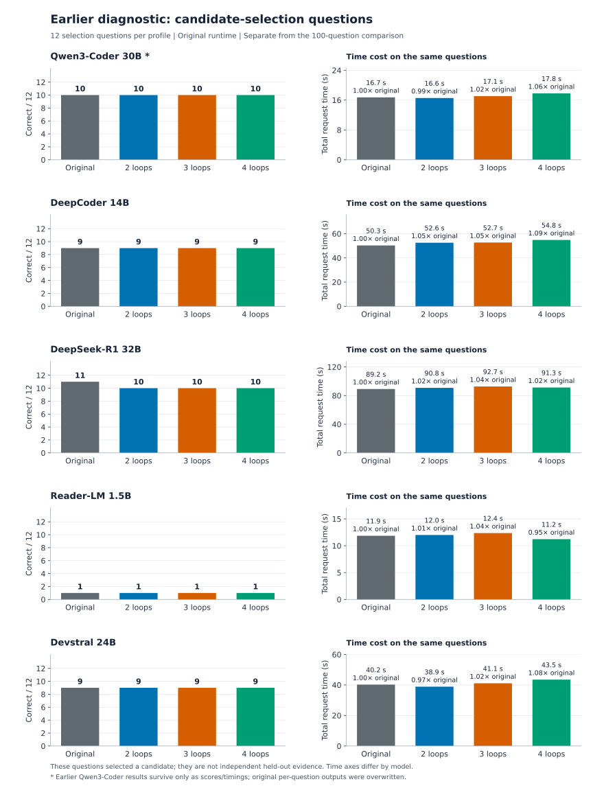
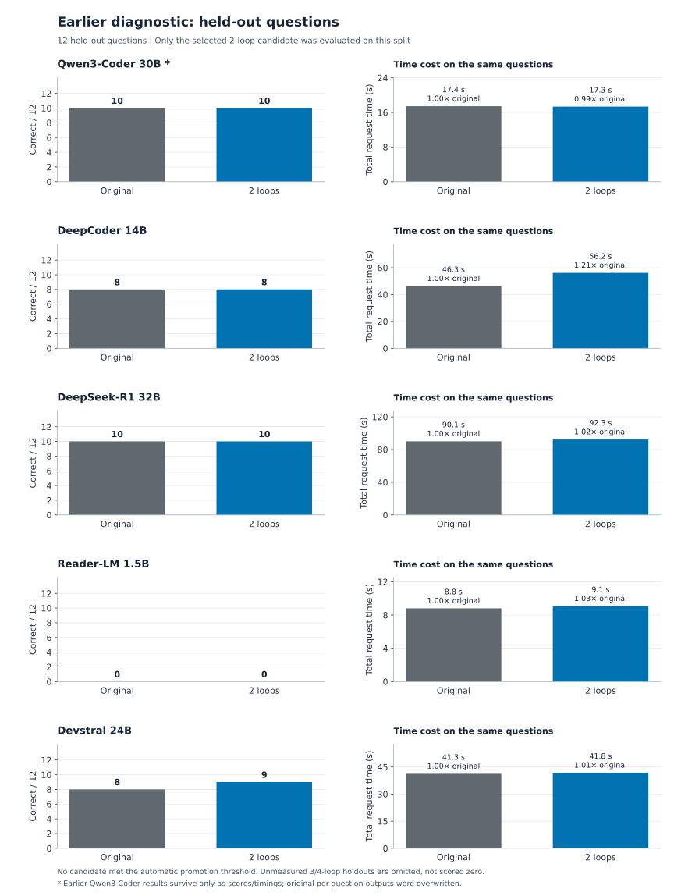
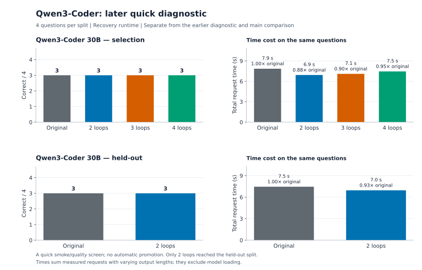
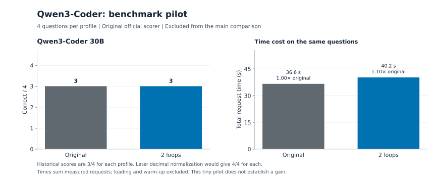

# Correct answers and time cost

These charts show **every retained quality comparison**: the main four-model study, both splits of the earlier five-model diagnostic, the later Qwen quick run and the pilot. All 54 measured rows come from the public [performance CSV](research-data/performance.csv). [Generated answers, timings and grading records](research-data/README.md) are available for independent analysis.

Correct answers are counts out of the stated question total. Time cost is the sum of measured request latencies, with the ratio to the original model shown on each bar. The time axes vary by model; compare the labeled numbers and ratios. Loading and warm-up are excluded, and output lengths can differ. This is measured inference time, not energy use or a dollar-cost estimate.

## Main comparison: 100 questions per profile

[Download PNG](charts/qwen-quality-performance.png) · [Download vector SVG](charts/qwen-quality-performance.svg) · [Full protocol, scores and paired statistics](qwen-public-benchmark.md)

No accuracy change was statistically significant after correction across all 12 comparisons. Qwen3-Coder's best observed score was 88/100 at three loops versus 84 originally; DeepSeek-R1's was 78 at two loops versus 72. DeepCoder scored lower at every loop count. Reader-LM's intended HTML-conversion task was not tested. Every looped batch took longer.

## Earlier diagnostic: selection split

[Download PNG](charts/diagnostic-selection-performance.png) · [Download vector SVG](charts/diagnostic-selection-performance.svg)

These questions selected a candidate, so their scores are not held-out evidence. The earlier runtime and constrained answer format differ from the main comparison. **Asterisks mark the older Qwen run, whose scores and timings remain available but whose per-question outputs were overwritten.**

## Earlier diagnostic: held-out split

[Download PNG](charts/diagnostic-holdout-performance.png) · [Download vector SVG](charts/diagnostic-holdout-performance.svg) · [Per-model summary table](README.md#initial-local-model-results)

Only the selected two-loop profile reached this split. Three- and four-loop holdout scores were not measured. Devstral gained one correct answer, from 8/12 to 9/12; the other four selected profiles tied their originals. No result met the automatic promotion threshold.

## Later Qwen quick diagnostic

[Download PNG](charts/qwen-quick-performance.png) · [Download vector SVG](charts/qwen-quick-performance.svg) · [Original report](qwen-recovery-quality.json)

This was a small check after runtime recovery, separate from the earlier 12-question diagnostic and the 100-question benchmark. Its retained answer records are included in the public data.

## Benchmark pilot

[Download PNG](charts/qwen-pilot-performance.png) · [Download vector SVG](charts/qwen-pilot-performance.svg) · [Original pilot records](research-data/qwen-lm-eval-pilot)

The pilot used the original official scorer, yielding 3/4 for both profiles. Later decimal normalization would score both 4/4. Its historical results are preserved rather than silently rewritten, and it is excluded from the main comparison.

## Models without quality measurements

The [54-file compatibility survey](all-local-survey.md), [API checks](README.md#earlier-integration-and-diagnostic-records) and [coverage CSV](research-data/model-coverage.csv) also cover models without correct-answer comparisons. Those checks establish loading, looping or integration behavior; they cannot supply missing quality bars. In particular, GPT-OSS 120B abliterated has compatibility and chat results, but no baseline-versus-looped quality benchmark.

The [plotting script](../scripts/plot_results.py) regenerates all five figures from the CSV, checks that every measured row appears in a chart and writes a [source/hash manifest](charts/manifest.json). No inference runs were added for these charts.
